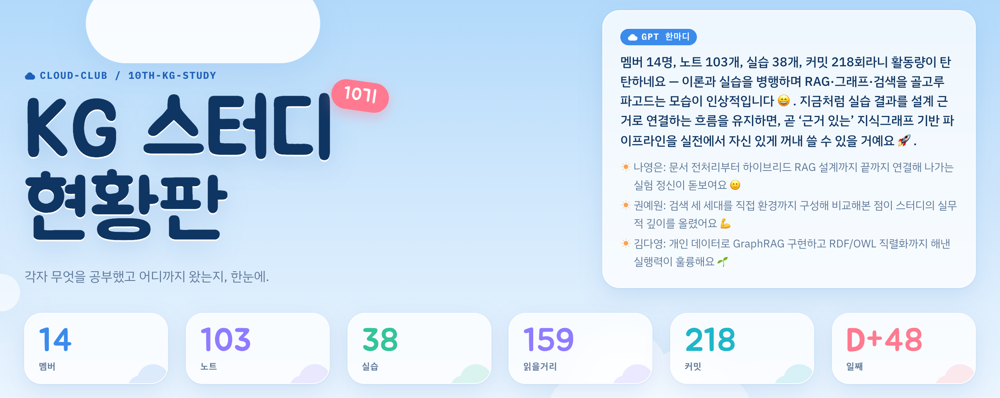
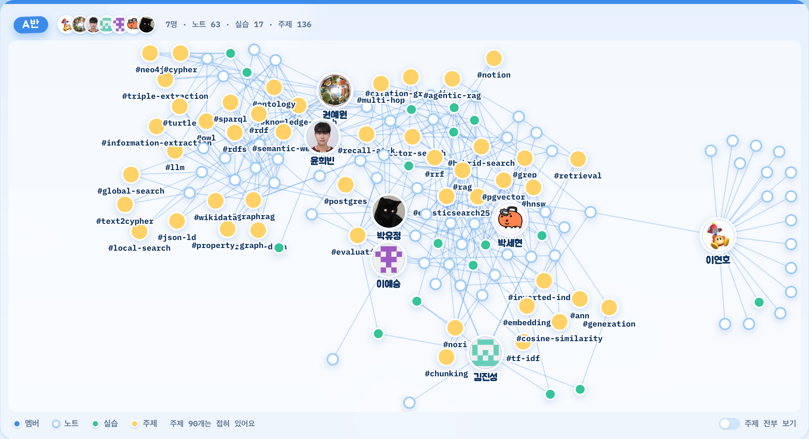

<!-- _class: lead -->
<!-- _paginate: false -->
<!-- _footer: "" -->

# 10기 KG(Knowledge Graph) 스터디

클라우드클럽 · grep에서 GraphRAG까지 6주 결과 공유

<!--
5분 발표. 순서: 숫자 → 6주 흐름 → 핵심 발견 → 현황판 시연 → 팀원 실습 → LLM 위키 → 요약.
-->

---

## 15명이 6주 동안 노트 107편과 실습 37개를 쌓았다

| 항목 | 수치 |
| --- | --- |
| 기간 · 멤버 | 2026-08-31부터 6주 · 15명 |
| 노트 · 실습 | 107편 · 37개 |
| 커밋 · PR | 292 · 49 (머지 46) |
| 위키 | 51페이지 · 위키링크 1,363개 |
| 멤버 간 모순 표시 | 19곳 |

데이터가 모두 달랐다. 카카오톡·Notion·인스타그램·판례·공시·회사 문서를 썼다.

<!--
같은 기법을 서로 다른 데이터에 돌려 본 것이 이 스터디의 가장 큰 자산이다.
저장소에 폴더를 만든 사람은 14명이다. 수치는 2026-10-18 main 기준.
-->

---

## 1~3주차는 "무엇을 찾을까", 4~6주차는 "어떻게 이을까"였다

- 1주 데이터·개인정보 → 2주 검색 세 세대 → 3주 하이브리드·RAG·평가
- 4주 RDF·OWL·SPARQL → 5주 트리플 추출·적재 → 6주 **GraphRAG**

<!--
각 주차는 앞 주차가 못 푼 질문에서 출발했다. grep이 놓친 표현 차이를 BM25와 벡터가, 한 번 검색으로 못 모으는 근거를 그래프가 맡았다.
-->

---

## 실측해 보니 교과서의 상식 두 가지가 그대로 맞지는 않았다

### RRF는 항상 이기지 않는다

- 평가셋 11개 중 모든 k에서 최고인 곳은 **1개**
- 가장 큰 40문항 평가에서는 졌다
- 한쪽에서만 상위인 정답이 밀려난다

### 멀티홉이라고 그래프가 필요하지 않다

- 기준은 홉 수가 아니라 **한 번의 검색**으로 근거가 모이는가다
- 세 멤버가 RAG로 풀린 반례를 냈다

텍스트가 비슷하다고 관계가 정확한 것은 아니다(박도연).

<!--
RRF: e0ng 10문항만 전 k 최고, yujeong430 40문항에서 패배. 네 멤버에게서 같은 패배 패턴.
멀티홉: dldusgh318 M01, Yeongeunn q10, do-dop q009.
-->

---

## 6주차 GraphRAG는 관계·다중 홉 질문에서만 이겼다

| 멤버 · 데이터 | v1 청크 검색 | v2 그래프 결합 |
| --- | --- | --- |
| 김다영 · 캡션 17건 | 다중 홉 Recall@5 0.00~0.50 | **1.00** |
| 이성현 · 회사 문서 | 사실 항목 3/9 | 9/9 (경로 고정) |
| 윤희빈 · OS 노트 | 설명 질문 정답 | 거의 같다 |
| 이연호 · 20청크 표본 | X01 wrong | partial |

전체 개수를 세는 질문은 Top-k로 못 풀고 Cypher 전체 조회가 필요했다.

<!--
kdyann 단순 질문은 둘 다 1.00. sunghyun v2 일부 답은 Neo4j 행으로 만든 템플릿이라 본인이 "자율 추론으로 해석하지 않는다"고 했다.
dldusgh318은 PR #45 미머지, 그래프를 거쳐 들어온 정답 청크는 0건.
-->

---

<!-- _class: bignum -->

# 4/9 → 3/9

모델에게 그래프 경로를 고르게 하자 점수가 오히려 떨어졌다

이성현, GLM-5.2 에이전틱 검색 · 346청크 · 4문항 · 그래프 도구 유무만 바꿔 비교

<!--
틀린 원인: Task→Issue→Test Case 대신 Task→Test Case 직접 경로를 조회해 18개라고 답했다(정답 13).
결론: 그래프는 맞는 경로를 골랐을 때만 이긴다. 코드가 경로를 정한 v2는 9/9였다.
-->

---

## 누가 어디까지 왔는지는 현황판이 보여 준다

푸시마다 **자동 배포**하고 GPT가 커밋을 중계한다 · [현황판 바로 가기](https://cloud-club.github.io/10th-KG-study/)

<!--
여기서 브라우저로 현황판을 직접 연다: https://cloud-club.github.io/10th-KG-study/
순서: 상단 숫자 → 중계석 → 지식그래프 → 멤버 카드.
현황판 숫자(멤버 14명)는 저장소에 폴더가 있는 인원이라 2장의 15명과 다르다.
-->

---

## 노트 태그가 반별 지식그래프의 주제 노드가 된다

<!--
멤버 → 노트·실습 → 주제, 두 명 이상 겹친 주제만 그린다. A반·B반을 따로 그린다. 6주차 태그(#graphrag, #text2cypher, #local-search)가 새로 붙은 것을 보여 준다.
-->

---

## 팀원마다 자기 데이터로 다른 실습을 만들었다 (1/2)

| 이름 · id | 데이터 | 대표 실습과 결과 |
| --- | --- | --- |
| 이연호 · dldusgh318 | Notion 1,562청크 | RRF Recall@5 0.534, W6 비교 |
| 박도연 · do-dop | 기업 공시 69청크 | 정규화 융합 vs RRF 역전 |
| 권예원 · e0ng | 활동 Notion | 그래프 엔티티 246 |
| 윤희빈 · heebindev | OS 노트 454청크 | GraphRAG v2 + Text2Cypher |
| 김진성 · jjinthung | 카카오톡 | BM25 + 벡터 + RRF 리트리버 |
| 김다영 · kdyann | 인스타그램 | 트리플 589, 다중 홉 1.00 |
| 신웅비 · kungbi | 합성 데이터 | 근거 기반 KG, 테스트 50 |

<!--
수치는 각 멤버 README 기준. 표는 저장소에 폴더가 있는 14명이다.
-->

---

## 팀원마다 자기 데이터로 다른 실습을 만들었다 (2/2)

| 이름 · id | 데이터 | 대표 실습과 결과 |
| --- | --- | --- |
| 이예승 · lys0611 | 카카오톡 1,922청크 | 34문항 Recall@5 0.907 |
| 조승아 · sdunge | 형사 판례 73건 | grep vs BM25 비교 |
| 박세현 · sese2204 | 카카오톡 | 인프라·현황판·위키 |
| 이성현 · sunghyun | 회사 문서 2,685청크 | 에이전틱 4/9 → 3/9 |
| 지유리 · ur2e | 합성 vault | 작업 기록 검색 |
| 나영은 · Yeongeunn | 팀 Notion 1,369청크 | 트리플 373 |
| 박유정 · yujeong430 | 카카오톡 814청크 | 40문항 평가 |

<!--
id-이름 매핑은 members/names.json. sese2204 실습 3개는 PR #6·#42에 있다.
-->

---

## 흩어진 노트 107편은 LLM이 관리하는 위키로 모았다

### 소재

`members/`는 불변이다. 에이전트는 읽기만 한다

### 위키

에이전트가 쓰고 잇는다. **누가 무엇을 확인했나**를 붙인다

### 스키마

`CLAUDE.md`에 규칙을 두고 훅으로 강제한다

매주 월요일 GitHub Actions가 Claude Code로 자동 정리해 PR을 올린다.

- 지금 위키는 **51페이지**이고, 멤버 노트끼리 결론이 다른 19곳을 양쪽 출처와 함께 표시했다

<!--
Karpathy의 LLM Wiki 패턴. 원문에 없던 모순 표시와 출처 추적을 스키마로 채웠다.
옵시디언 그래프 뷰를 보여 줄 수 있으면 여기서 연다.
-->

---

## 최신 지식베이스 흐름도 네 갈래로 따라갔다

| 주제 | 붙잡은 한 줄 |
| --- | --- |
| LLM 위키 | RAG 앞단의 정제된 코퍼스다 |
| OpenViking | 과거 결론은 재검증의 출발점이다 |
| Palantir Ontology | Action(쓰기)까지 담는 운영형 온톨로지다 |
| 기업 KG 사례 | LLM이 만든 관계는 후보다 |

남은 일은 전체 데이터로 그래프를 만들어 같은 질문으로 다시 재는 것이다.

<!--
GraphRAG는 앞 장에서 다뤘다. 다음 기수에 넘길 것: 공정 비교, 공용 골든셋, 멤버 그래프 통합.
-->

---

## 요약: 검색은 쌓였고, 그래프는 맞는 경로일 때만 이겼다

1. 15명이 6주 동안 노트 107편과 실습 37개를 쌓았다
2. "무엇을 찾을까"에서 "어떻게 이을까"로 넘어갔다
3. RRF도 그래프도 데이터에 따라 결과가 갈렸다
4. 경로를 모델에게 맡기면 오히려 떨어졌다(4/9 → 3/9)
5. 현황판과 LLM 위키가 사람과 지식을 각각 추적한다

[현황판](https://cloud-club.github.io/10th-KG-study/) · [저장소](https://github.com/cloud-club/10th-KG-study)

<!--
감사 인사. 질문 예상: 위키 정확도는 누가 검증하나 → 멤버가 자기 노트를 고치면 다음 ingest에서 반영된다.
-->
