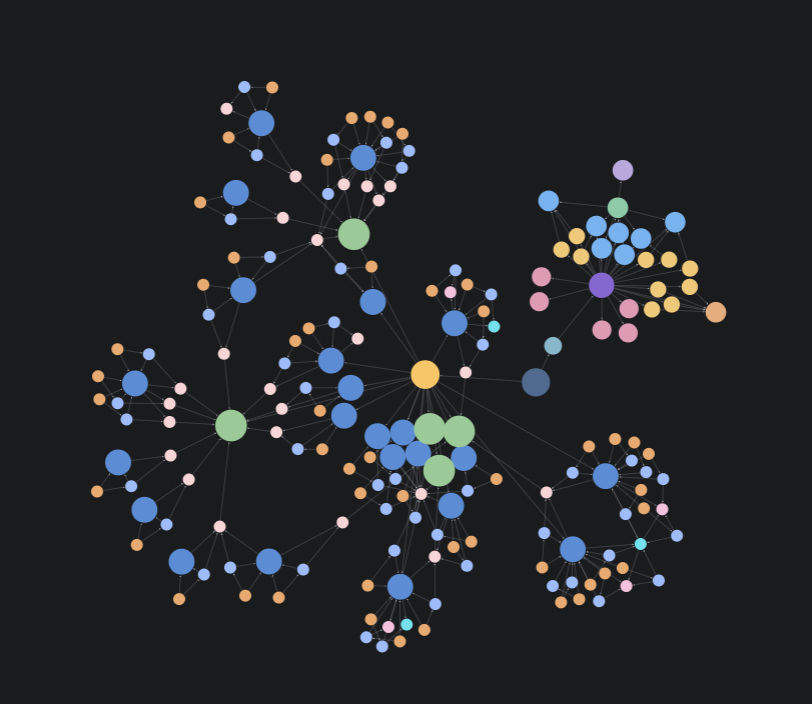

# W7 — 지식 그래프로 연결한 앱 운영과 성과 분석

기존 콘텐츠 지식 그래프에 앱 운영 영역을 연결하고, 7개 도구의 데이터를 하루 한 번 수집해 통합 보고서로 확인하는 흐름을 만들었다. 도구별 지표의 의미와 출처를 그래프에 연결해 같은 기준으로 성과를 비교할 수 있도록 했다.

## 구현 결과

| 결과 | 구현 내용 |
| --- | --- |
| 통합 지식 그래프 | 기존 콘텐츠와 앱 운영을 공통 작업 공간 아래 별도 영역으로 연결 |
| 분석 기준 | 도구 역할, 데이터 출처, 지표 정의, 집계 규칙을 Neo4j에 저장 |
| 원본 도구 연결 | API, 권한 연결과 이벤트/사용자 식별 기준 매핑 완료 |
| 일일 수집·검증 | 하루 한 번 수집하고 누락이나 중복 확인 |
| 통합 보고서 | 광고 성과, 온보딩 퍼널, D1 리텐션, 결제 소요시간과 국가와 OS별 현황 제공 |
| 프로젝트 소개 | 전체 그래프 이미지와 보고서 링크를 포함한 독립 HTML 문서 |

## 지식 그래프 구조

```text
내 작업 공간
├─ 콘텐츠 계정 → 기존 게시물 및 다른 게시물 주제, 근거 연결
└─ 앱 운영 프로젝트 → 분석 에이전트
                       ├─ 도구 역할, 데이터 출처
                       ├─ 지표 정의 및 분석 규칙
                       └─ 보고서 설계
```

콘텐츠와 앱 운영은 같은 KG에 두고 프로젝트·계정 경계로 조회 범위를 구분했다. 그래프에는 숫자를 해석할 기준을 저장하고 최신 성과는 원본 도구에서 조회한다. 광고 설치와 앱 첫 실행, 무료 체험과 유료 결제를 구분하고 동일한 기간·사용자 집단을 기준으로 비교하도록 했다.

### Neo4j 그래프 화면



Neo4j에서 조회한 전체 지식 그래프다. 동그라미는 계정·게시물·주제·프로젝트·분석 설계 등의 대상을, 선은 대상 사이의 관계를 나타낸다. 여러 노드가 모인 군집과 군집 사이의 연결을 통해 개별 정보가 어떤 맥락으로 이어지는지 살펴볼 수 있다.

기존 콘텐츠 영역의 게시물·주제·근거 연결에 앱 운영 프로젝트의 분석 에이전트·도구·지표 정의·분석 규칙·보고서 설계를 연결한 구조다. 이 화면은 노드 이름이 생략된 전체 연결 모습이며, 각 대상과 관계의 세부 내용은 아래 그래프 조회 파일로 확인할 수 있다.

| 도구 | 연결한 역할 |
| --- | --- |
| GA4 | 유입 |
| Amplitude | 퍼널, 코호트, 리텐션 |
| Google AdMob | 앱 내부 광고 수익 |
| RevenueCat | 체험, 구독, 유료 전환 |
| Firebase | 앱 이벤트, 설정 |
| Cloudflare Analytics | 트래픽, 요청, 성능 |
| Supabase | 앱 DB, 인증, 제품 상태 |

## 다음 단계: 실험 결과를 읽는 AI

실험 내용과 변경 이력, 성과 변화와 이탈 지점을 AI에 연결한다. 어디를 고쳐야 할지, 다음에 무엇을 시도할지 제안하는 일을 하게 하고싶다. 

```text
실험 내용 · 변경 이력 → 성과 비교 · 이탈 지점 확인 → AI 개선 제안 · 다음 실험
```

## 그래프 조회 파일

| 파일 | 표시 범위 |
| --- | --- |
| [connected_graph.cypher](connected_graph.cypher) | 전체 그래프 표시 |
| [analytics_design.cypher](analytics_design.cypher) | 계정, 앱 프로젝트와 분석 설계 |
| [analytics_overview.cypher](analytics_overview.cypher) | 작업 공간의 두 영역과 분석 에이전트의 연결 |
| [analytics_browser.grass](analytics_browser.grass) | Neo4j Browser 표시 스타일 |

## 그래프 재적재

저장소 루트에서 `NEO4J_PASSWORD`를 설정한 뒤 실행한다. 선택 환경 변수는 `NEO4J_URI`, `NEO4J_USER`, `NEO4J_DATABASE`다.

```bash
members/kdyann/labs/01-instagram-search/.venv/bin/python members/kdyann/labs/07-analytics-agent/src/add_analytics_design.py
```
