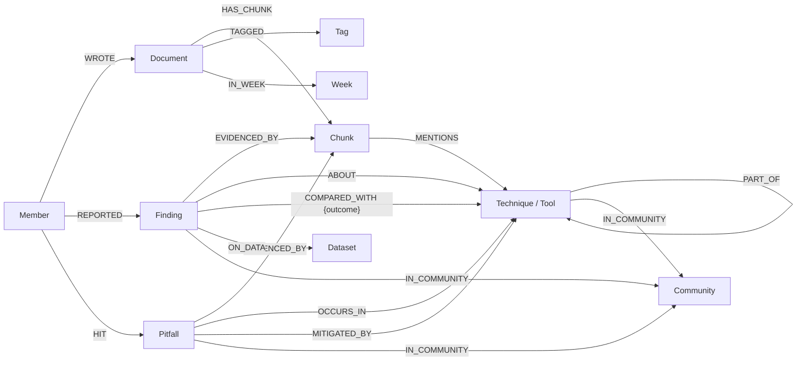
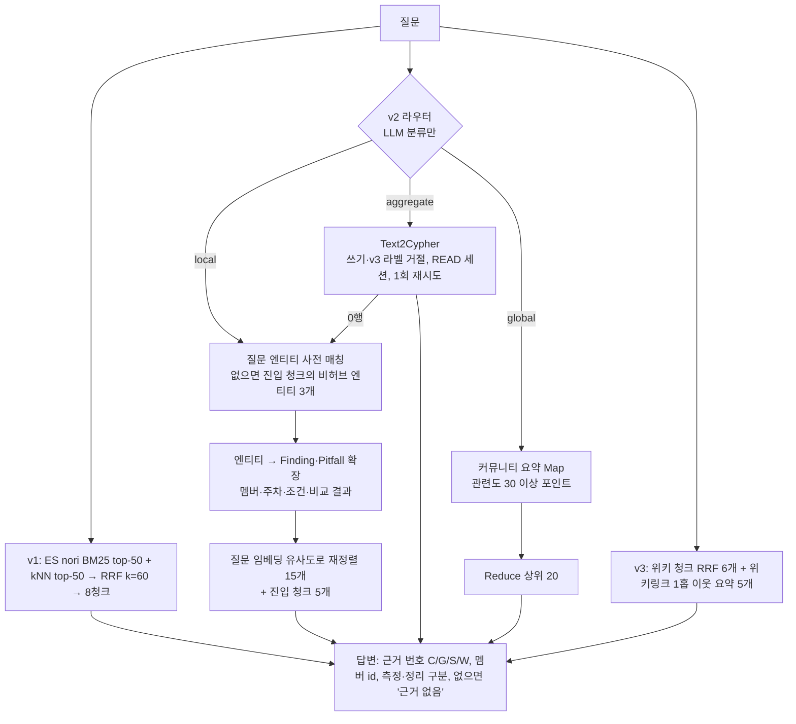

# 11. 저장소 자체로 GraphRAG 만들기

> 참고 자료:
> - 실습: [`labs/07-repo-graphrag/`](../labs/07-repo-graphrag/README.md) (PR #50) — 코드, 결과표, `demo.cypher`, 그래프 스냅샷
> - 질의–답변 원문: [`labs/07-repo-graphrag/QA.md`](../labs/07-repo-graphrag/QA.md) — 질문 12개 × 세 방식
> - 위키: [GraphRAG](../../../wiki/concepts/GraphRAG.md) · [Text2Cypher](../../../wiki/concepts/Text2Cypher.md) · [폐쇄 스키마 설계](../../../wiki/concepts/폐쇄-스키마-설계.md)
> - 내 노트: [08. LLM 위키](08-llm-wiki.md)
> - [Microsoft GraphRAG — Global Search](https://microsoft.github.io/graphrag/query/global_search/)

## 한 줄 요약

10기 저장소의 멤버 노트·실습 177편을 **파서로 만든 구조 그래프**와 **닫힌 스키마로 추출한 의미 그래프**로 쌓았다. 그 위에 청크 검색(v1), GraphRAG(v2), LLM 위키(v3)를 붙여 같은 질문 12개를 던졌다. 그래프는 **세기(집계)와 모으기(교차 멤버)에서만** 이겼다. 그래프 품질의 상한은 **추출 모델**이었다. 싼 모델(gpt-5.4-mini)로 뽑은 승패 방향은 13%만 맞았고, 추론 모델(gpt-5.6-terra)은 90%였다. 질문 12개로는 정답률 차이를 말할 수 없어서(아무것도 바꾸지 않아도 1점이 흔들렸다) 답변을 정성으로 읽었다.

## 핵심 개념

- **LLM이 정하는 범위를 최소로 줄인다.** 누가 썼는지, 엔티티 이름, 기법 사이의 분류는 파서와 사람이 정한다. LLM은 "실험 결과"와 "겪은 함정"만 뽑는다.
- **근거가 곧 진입로다.** 추출한 사실마다 원문 청크를 `EVIDENCED_BY`로 묶었다. 청크 검색으로 들어와 그래프로 넓히고, 그래프 사실에서 다시 원문으로 돌아간다.
- **경로는 코드가 정한다.** LLM은 질문을 세 경로(local · aggregate · global) 중 하나로 *분류만* 한다. 질의 자체는 코드가 만들거나, 검증을 통과한 Cypher만 실행한다.
- **추출에는 좋은 모델, 답변에는 싼 모델.** 그래프는 한 번 만들어 계속 쓰는 빌드 시점 자산이라 정확도에 돈을 쓸 곳이다. 답변 생성은 근거가 맞으면 싼 모델로 충분했다.
- **LLM 위키는 미리 계산한 글로벌 요약이다.** 위키가 이미 답을 써 둔 질문에는 강하고, 세어야 하는 질문에는 약하다. 위키 문장에 끌려가기도 한다.

## 상세 정리

### 1. 데이터 — 왜 이 저장소인가

- 소재: `members/<id>/`의 notes·labs md·readings·README 177편(`main` `fd8b7f6`, 미머지 PR 제외). 실습 데이터(`dataset/`, `note-templates/`)는 뺐다.
- 청킹: `#`~`###` 제목 단위로 나누고, 길면 문단 경계에서 1,200자 이하로 자른다. 40자 미만은 버린다. 결과는 **1,928청크, 89만 자**.
- 이 데이터가 좋은 이유는 세 가지다.
  - 그래프의 절반을 LLM 없이 만들 수 있다. 폴더가 작성자이고, frontmatter가 태그·날짜다.
  - 위키가 이미 정답을 많이 정리해 둬서 gold를 원문과 대조하기 쉽다.
  - 청중(멤버들)이 데이터 안에 있다.

### 2. 그래프 구조 — 다섯 층



| 층 | 노드 (개수) | 관계 | 누가 만드나 |
|---|---|---|---|
| ① 구조 | Member 14 · Document 177 · Chunk 1,928 · Tag 156 · Week 6 | WROTE · HAS_CHUNK · TAGGED · IN_WEEK | 파서 (결정적) |
| ② 사전 | Technique 46 · Tool 18 | PART_OF 17 · MENTIONS 5,362 | 사람이 큐레이션한 사전 + 별칭 정규식 (결정적) |
| ③ 의미 | Finding 215 · Pitfall 204 · Dataset 10 | ABOUT 396 · COMPARED_WITH 98 · ON_DATA 92 · OCCURS_IN 376 · MITIGATED_BY 79 · EVIDENCED_BY 419 | LLM 추출(gpt-5.6-terra) + 검증 |
| ④ 커뮤니티 | Community 10 | IN_COMMUNITY 462 | Leiden + LLM 요약 |
| ⑤ 위키 (v3 전용) | WikiPage 53 · Contradiction 20 | LINKS_TO 585 · CITES 564 · CREDITS · INVOLVES | 파서 |

전체 규모는 노드 2,857개(임베딩 제외), 관계 1만 2,187개다.

#### ① 구조 층 — LLM 없이

- 작성자는 폴더명에서 정한다. git author가 아니다.
- 주차는 추정치다. 공식 커리큘럼 문서가 없어서 **제목의 "N주차" → 경로의 `weekN` → 날짜 구간** 순으로 정했다.
  - 처음에는 경로 정규식이 `09-week4`의 `09`를 주차로 읽었다.
  - 날짜만으로 정하면 노트를 몰아서 올린 멤버(sunghyun 1~4주차를 09-30에 커밋)가 전부 5주차가 된다. 그래서 제목을 먼저 본다.
  - 최종적으로 제목 18편, 경로 21편, 날짜 138편으로 정해졌다.

#### ② 사전 층 — 엔티티 이름을 먼저 닫는다

- 5주차 [폐쇄 스키마](../../../wiki/concepts/폐쇄-스키마-설계.md)는 **술어**를 닫았다. 여기서는 **엔티티 이름**까지 닫았다.
- 근거는 노트 태그 156개와 위키 페이지 이름이다. 위키에서는 이름만 가져오고 내용은 가져오지 않았다.
- `entities.yaml` 한 항목은 `RRF: {aliases: [rrf, reciprocal rank fusion], part_of: 하이브리드 검색}` 꼴이다.
- 이 사전으로 두 가지를 얻는다.
  - `MENTIONS`를 정규식 매칭만으로 만든다(5,362개).
  - LLM이 `Vector Search`·`Turtle`처럼 별칭으로 써도 정규 이름으로 되돌린다.
- **사전 밖 이름 누수는 0건이다.** 5주차 엔티티 신원해소 문제("RRF" vs "Reciprocal Rank Fusion")가 처음부터 생기지 않는다.

#### ③ 의미 층 — LLM은 두 가지만 뽑는다

| 클래스 | 뜻 | 아닌 것 |
|---|---|---|
| `Finding` | 실험·비교의 **결론**. `kind` = measured(직접 실험) / cited(인용) | 실험 설정, 계획, 의견 |
| `Pitfall` | **실제로 부딪힌** 실패·오류·한계 | 교과서식 일반론, 안전장치, 해석상 단서 |

- **Finding을 중간 노드로 둔 이유:** 위키의 핵심 정보가 "누가 무엇을 **어떤 조건에서** 확인했나"이기 때문이다. `metric`·`value`·`condition`·`claim`을 한 노드에 묶는다(dldusgh318의 `TechnologyUse` 방식).
- **`kind`를 둔 이유:** 위키 규칙 "정리했다 ≠ 측정했다"를 스키마에 옮겼다.
- **작성자는 LLM에 묻지 않는다.** `Finding -EVIDENCED_BY-> Chunk <-HAS_CHUNK- Document <-WROTE- Member` 경로로 정해진다. `(Member)-[:REPORTED]->(Finding)`은 이 경로를 접어 둔 파생 관계다.
- **채택 기준:**
  - `evidence`(30~150자 원문 복사)가 그 청크에 실제로 있어야 한다(공백 정규화 후 부분 문자열).
  - 엔티티가 사전에 있어야 하고, 지표만 있고 대상이 없으면 탈락한다.
  - 자기 자신과의 비교는 버리고, 같은 청크의 같은 결론은 하나로 합친다.
  - 스키마에 맞지 않는 사실은 버리지 않고 `review_queue`로 모은다(heebindev 처방).
- **프롬프트 v1 → v2:**
  - v1에서 mini는 kdyann의 질문별 표 한 줄 한 줄을 Finding 6건으로 쪼갰고, "검색 시간은 합산해 기록했다" 같은 설정까지 결론으로 뽑았다. `about`에 지표(Recall@k)를 넣고, 안전장치를 함정으로 분류했다.
  - v2에는 "표는 하나로 묶어 value에 요약", "about은 평가 대상만", "설정은 condition에만", "함정은 실제로 부딪힌 것만"을 넣었다.
- **Dataset 정규화는 두 번 틀렸다.**
  - LLM이 `"null"`을 문자열로 돌려줘서 "null"이라는 Dataset 노드가 생겼다.
  - "lab 노트"·"개인 노트"처럼 종류를 알 수 없는 표현 42개를 전부 `옵시디언 노트`로 묶었다.
  - "출처가 명시된 경우만 유형을 붙이고 나머지는 null"이라는 규칙을 넣어 고쳤다. LLM 정규화 결과는 사람이 한 번 봐야 한다.

#### ③-1. 추출 모델 비교 — 그래프 품질의 상한은 여기서 정해진다

처음에는 `gpt-5.4-mini`로 전체를 추출했다(Finding 923, Pitfall 495). 질문 채점에서 그래프 쪽 오답을 추적하니 원인이 추출이었다. 그래서 추출한 사실 하나하나를 원문 청크와 대조하는 채점기(`judge_extract.py`, 심판 `claude-sonnet-5-5`)를 만들고, 추출만 `gpt-5.6-terra`로 바꿔 비교했다.

| 원문 대조 (전체에서 무작위, seed 42) | gpt-5.4-mini | gpt-5.6-terra |
|---|---:|---:|
| Finding 내용이 원문과 맞음 (60건) | 82% | 88% |
| 측정/인용 구분이 맞음 (60건) | 58% | **100%** |
| **승패 방향이 맞음** (방향 있는 것만 30건) | **13%** | **90%** |
| Pitfall 내용이 원문과 맞음 (40건) | 85% | 95% |
| 실제로 부딪힌 함정임 (40건) | 35% | 88% |
| 개수: Finding / 직접 측정 / Pitfall | 923 / 279 / 495 | 215 / 187 / 204 |
| 토큰: 입력 / 출력(추론 포함) | 87만 / 32.3만 | 87만 / **16.0만** (추론 6.3만) |

- **mini의 승패 방향은 사실상 무작위였다.** RRF 정의만 있는 청크에 "점수 정규화 융합에 이겼다"를 지어내고, "목표·계획" 절을 결과로 뽑았다. 그래서 `COMPARED_WITH` 위의 모든 비교 질문이 오염됐다.
- **terra는 덜 뽑고 정확하게 뽑는다.** 출력 토큰이 절반이라 비용은 단가 차이만큼만 늘었다. 대신 인용(cited) Finding은 28건만 남겼다. 프롬프트가 인용도 뽑으라고 했지만 직접 실험에 집중했다. "누가 무엇을 공부했나"는 `MENTIONS`가 담고 있으니 손실이 크지 않다.
- terra의 오답은 대부분 **청크에 없는 정보를 덧붙이는 것**이었다. 옆 청크의 청크 수나 데이터 이름을 끌어오는 식이다.
- 교훈: **추출은 빌드 시점에 한 번 내는 비용이고, 그 결과를 모든 질의가 물려받는다.** 여기에 돈을 아끼면 그래프 전체가 틀린 사실의 저장소가 된다. 5주차 dldusgh318의 "형식 통과 99%"와 heebindev의 "의미 오류 3/8"이 다른 숫자였던 것처럼, `evidence` 문자열 검증 통과율과 의미 정확도는 따로 재야 한다.

#### ④ 커뮤니티 층 — 6주차에 아무도 못 한 글로벌 서치

- **투영:** Finding·Pitfall과 그 엔티티를 ABOUT·COMPARED_WITH·OCCURS_IN·MITIGATED_BY로 잇고, 엔티티끼리는 PART_OF로 잇는다. terra 그래프에서 노드 483개, 엣지 811개다.
- **청크 공동 언급(MENTIONS)은 넣지 않았다.** `RAG`·`지식그래프`처럼 거의 모든 청크에 나오는 허브가 전부를 한 덩어리로 묶는다.
- **탐지:** `leidenalg` RBConfiguration, resolution 1.0, seed 42. 커뮤니티 25개, modularity 0.649였다. 노드 4개 이상인 10개만 LLM으로 요약했다(제목, 3~5문장, 멤버 id를 붙인 핵심 6줄).
- **GDS를 쓰지 않은 이유:** 사내망 SSL 가로채기로 플러그인 다운로드가 막혔다. 그래서 igraph로 계산하고 결과만 Neo4j에 썼다.
- **Leiden이 우리 커리큘럼을 다시 찾았다.** mini 그래프(노드 1,482)에서도, terra 그래프(483)에서도 커뮤니티가 주차 주제와 거의 같은 단위로 나왔다.

| 커뮤니티 (terra) | 크기 | 멤버 | 묶인 엔티티 |
|---|---:|---:|---|
| C0 검색기법 비교와 융합 함정 | 124 | 11 | BM25, 임베딩, 코사인 유사도, HNSW, 하이브리드 검색 |
| C1 지식그래프 추출·검증 쟁점 | 69 | 10 | 온톨로지, RDFS, OWL, 닫힌 스키마, 트리플 추출 |
| C2 RAG 검증과 실패 양상 | 61 | 9 | RAG, 근거 인용, 가명화 |
| C3 그래프 저장·질의 검증 | 60 | 7 | RDF, 프로퍼티 그래프, Cypher, GraphRAG, 로컬·글로벌 서치 |
| C4 문자열·의미 검색 비교 | 46 | 12 | grep, n-gram, pgvector |
| C5 멀티홉 검색·추론 실패와 보완 | 39 | 6 | 쿼리 재작성, 에이전틱 검색, 멀티홉 질의 |
| C6 청킹과 검색평가 | 31 | 8 | 청킹, Recall@k, MRR, nDCG, RAG 평가 |
| C7 TF-IDF·BM25·Elasticsearch 한계 | 21 | 7 | TF-IDF, 키워드 검색, Elasticsearch, nori |
| C8 RAGAS 평가 지표와 심판 개선 | 6 | 1 | RAGAS |
| C9 리랭커 성능·지연·함정 | 5 | 2 | 리랭커 |

#### ⑤ 위키 층 — v3 전용으로 격리

- 위키는 같은 노트를 LLM이 미리 합성한 결과다. v1·v2 코퍼스에 섞으면 정답이 새어 들어간다.
- 그래서 `WikiPage`·`Contradiction`·`wiki_chunks` 인덱스는 v3만 읽는다. Text2Cypher도 이 라벨을 쓰면 거절한다.

### 3. RAG를 어떻게 붙였나



#### v1 — 청크 하이브리드 (3주차와 같은 조건)

- Elasticsearch에 nori(`decompound_mode: mixed`, 품사 필터)로 BM25 색인과 `dense_vector`(gemini-embedding-2, 3072차원, cosine)를 함께 둔다.
- BM25 top-50과 kNN top-50을 순위로만 합치는 RRF(k=60)로 8청크를 고른다.
- 임베딩 입력에는 문서 제목과 소제목을 붙였다. 청크만 넣으면 어느 문서의 어느 절인지 잃는다.

#### v2 — GraphRAG, 세 경로

**local (로컬 서치)**

1. **시작점:** 질문 속 엔티티를 사전 정규식으로 찾는다(엔티티 링킹). 없으면 v1 진입 청크 8개에서 자주 나온 엔티티 3개를 쓴다. 이때 `RAG`·`지식그래프`·`임베딩`·`RDF` 같은 허브는 질문에 직접 나오지 않는 한 쓰지 않는다.
2. **확장:** 아래 Cypher 한 번으로 엔티티 주변의 Finding·Pitfall과 그 작성자·문서·주차·데이터·비교 결과를 가져온다.

   ```cypher
   MATCH (e) WHERE (e:Technique OR e:Tool) AND e.name IN $ents
   MATCH (x)-[:ABOUT|COMPARED_WITH|OCCURS_IN|MITIGATED_BY]->(e)
   MATCH (m:Member)-[:REPORTED|HIT]->(x)-[:EVIDENCED_BY]->(c:Chunk)<-[:HAS_CHUNK]-(d:Document)
   OPTIONAL MATCH (x)-[:ON_DATA]->(ds:Dataset)
   OPTIONAL MATCH (x)-[cw:COMPARED_WITH]->(o)
   RETURN ...
   ```

3. **좁히기:** 질문에 멤버 id가 있으면 그 멤버의 사실만 남긴다.
4. **재정렬:** 사실 문장을 질문과의 임베딩 유사도로 다시 정렬해 상위 15개만 쓴다. 6주차에 dldusgh318이 보인 함정 때문이다. 확장해도 회수 순서가 나쁘면 무관한 근거가 자리를 차지한다.
5. **컨텍스트:** 그래프 사실 `[G1] kdyann · 6주차(추정) · 실험 · <결론> (Recall@5=… · 조건 · 데이터 · 비교 결과) ← 경로`와 v1 청크 5개 `[C1]`를 함께 넣는다.

**aggregate (Text2Cypher)**

- 스키마 설명, **정규 엔티티 이름 전체 목록**, 규칙을 주고 Cypher를 생성하게 한다.
- 검사:
  - 쓰기 구문(`CREATE|MERGE|DELETE|SET|REMOVE|DROP|LOAD CSV|FOREACH`, `apoc.create…`, `CALL db.`)과 v3 라벨은 거절한다.
  - `LIMIT`이 없으면 붙인다.
  - `READ` 모드 세션에서 15초 제한으로 실행한다.
- 오류가 나면 오류 메시지를 주고 한 번 고쳐 쓰게 한다.
- **0행이면 "없다"고 답하지 않는다.** local 경로로 다시 찾는다. 6주차 sunghyun의 "0행은 없음이 아니다"를 경로 설계로 옮긴 것이다.

**global (글로벌 서치)**

- **Map:** 커뮤니티 요약마다 "이 질문에 도움이 되는 점"을 멤버 id와 관련도(0~100) 점수로 뽑는다.
- **Reduce:** 30점 이상인 포인트를 점수 순으로 20개 모아 답한다(Microsoft GraphRAG의 Global Search 구조).

#### v3 — LLM 위키

- 위키 페이지를 같은 방식으로 청킹해 409청크를 만든다(`## 출처`는 뺐다). v1과 같은 RRF로 6개를 고른다.
- 그 페이지들이 위키링크로 가리키는 이웃 페이지의 한 줄 정의를 5개 덧붙인다(동점은 이름순).

#### 답변 규칙 (세 방식 공통)

근거만 쓴다. 문장마다 `[C1]`·`[G2]`·`[S3]`·`[W4]`를 붙인다. 멤버 id를 밝히고 "정리했다"와 "측정했다"를 구분한다. 답할 수 없으면 "근거 없음"이라고 한다. 답변 생성은 `gpt-5.4-mini`로 한다.

### 4. 결과 — 점수는 참고, 읽기는 정성으로

질문 12개를 6주차 분류(단일 사실 · 교차 멤버 · 멀티홉 · 집계 · 글로벌 · 모순 · 근거 없음)로 만들었다. gold는 원문과 대조해 확정했다. 채점은 다른 계열인 `claude-sonnet-5-5`가 회차마다 1회 했다.

| 회차 | 바꾼 것 | v1 | v2 | v3 |
|---|---|---:|---:|---:|
| 1 | mini 추출 | 6.5 | 8.0 | 7.5 |
| 2 | + Text2Cypher 처방(정규 이름 목록, 0행 폴백) | 6.5 | 7.5 | 7.5 |
| 3 | + terra 추출 | 6.5 | 8.0 | 6.5 |
| 4 | + v3 이웃 동점 순서 고정 | 6.5 | 8.0 | 6.5 |

**3회차에 v3는 아무것도 바꾸지 않았는데 1점이 떨어졌다.** v1 답은 12개가 모두 이전 회차와 같았는데, v3 답은 12개가 모두 달랐다. 위키 이웃 쿼리의 동점 순서가 정해져 있지 않아서, DB를 다시 불러오며 컨텍스트가 바뀐 것으로 보인다. 그러니 0.5~1점 차이로는 아무것도 말할 수 없다. 그래서 [`QA.md`](../labs/07-repo-graphrag/QA.md)의 답변 원문을 질문별로 읽었다.

| 질문 유형 | 읽고 나서 본 것 |
|---|---|
| 단일 사실 (Q01·Q02) | 세 방식의 답이 거의 같다. v2 local도 결국 진입 청크를 인용했다. 답이 한 문서에 있으면 그래프는 덧붙일 것이 없다 |
| 교차 멤버 (Q03) | v1은 1명을 찾고 "다른 근거는 없다"고 단정했다. v3는 위키 덕분에 다섯 이름을 다 댔지만 조건·수치가 비고 스스로 모순됐다. v2(Text2Cypher)는 3명이지만 조건과 수치가 정확했다 |
| 교차 멤버 (Q04) | 셋 다 흔들렸다. 지표마다 승자가 바뀐 멤버가 있어서 답이 하나로 정해지지 않는 질문이었다 |
| 멀티홉 (Q05) | 셋 다 정답이었다. 한 문서에 다 적혀 있어 청크로 충분했다 |
| 집계 (Q06·Q07) | v2만 답했다. v1·v3가 Q07에서 숫자를 지어내지 않고 "근거 없음"으로 멈춘 것도 기록할 만하다 |
| 집계·함정 (Q08) | v1·v3는 "구현한 멤버 없음"을 근거와 함께 답했다. v2는 첫 문장에서 커뮤니티 탐지를 *언급한* 멤버를 "구현했다"고 했다가 뒤에서 뒤집었다 |
| 글로벌 (Q09) | 어느 방식도 사람이 쓴 최종 정리와 겹치지 않았다. 각자 자기 렌즈(v1 검색된 두 멤버, v2 커뮤니티 패턴, v3 위키 허브)로 답했다 |
| 글로벌 (Q10) | v3만 순서를 맞혔다. 위키 허브에 타임라인이 있다. 커뮤니티에는 시간이 없어서 v2는 순서를 재구성하다 틀렸다 |
| 모순 (Q11) | v1이 수치까지 가장 정확했다. v3는 역전 메커니즘 설명이 가장 좋았다 |
| 근거 없음 (Q12) | v3만 걸렸다. 위키의 "KURE(bge-m3를 한국어로 파인튜닝한 모델)" 문장을 보고 lys0611을 "파인튜닝으로 비교한 사람"으로 지목했다 |

## 인사이트

1. **그래프의 가치는 "세기"와 "모으기"에 있다.** 집계(Q06·Q07)는 Top-k 검색으로는 구조적으로 불가능했다. 교차 멤버 질문(Q03)에서는 그래프만 여러 멤버의 결과에 **정확한 조건과 수치**를 붙여 모았다. 반대로 답이 한 문서에 있는 질문(단일 사실, Q05 멀티홉, Q11 모순)은 청크 검색이 오히려 더 정확했다. 6주차 결론 "멀티홉이면 그래프가 아니라, 한 번 검색으로 근거가 모이느냐가 기준"이 같은 코퍼스에서 다시 맞았다.

2. **그래프 품질의 상한은 추출 모델이다.** mini로 뽑은 승패 방향은 13%만 맞았다. 그래프 위에서 "누가 무엇이 더 나았다고 측정했나"를 묻는 모든 질문이 그 13%를 물려받는다. terra로 바꾸자 90%가 됐고, 출력 토큰은 오히려 절반이었다. 그래프는 빌드 시점 자산이라 **추출에 좋은 모델을 쓰고 답변은 싼 모델로** 나누는 것이 맞다. 그리고 `evidence` 문자열 검증만으로는 이 차이를 볼 수 없었다. mini 결과도 문자열 검증은 통과했다. **의미 정확도는 원문 대조로 따로 재야 한다.**

3. **경로를 고르는 순간이 위험하다.** "누구이고 어떤 조건"이라는 표현은 라우터가 local 대신 aggregate로 보냈다. 1회차에 Text2Cypher는 관계 속성을 노드에서 찾고(`f.outcome`) 사전에 없는 이름(`'벡터 검색'`)을 써서 오류 없이 0행을 냈다. sunghyun의 에이전틱 실험(4/9 → 3/9)과 같은 구조의 실패다. 정규 이름 목록과 0행 폴백으로 처방했더니 다른 문항이 깨졌다(Q08). 프롬프트를 질문에 맞추는 것은 과적합이고, 필요한 것은 **질의 의도와 쿼리를 대조하는 사후 검증**이다.

4. **그래프 컨텍스트는 "관련 있음"과 "해당함"을 구분하지 않는다.** Q08에서 v2는 커뮤니티 탐지 엔티티 주변의 사실(그것을 *인용*하거나 *계획만* 한 멤버)을 받아, 첫 문장에서 그들을 "구현한 사람"이라고 했다. 엔티티 확장은 관련된 것을 다 가져온다. 그것이 질문의 조건(구현했나)을 만족하는지는 따로 표시해 줘야 한다. 사실마다 `kind`와 관계 종류를 앞에 붙이는 것이 다음 처방 후보다.

5. **LLM에게서 결정을 빼앗을수록 그래프가 단단해진다.** 작성자(경로), 엔티티 이름(사전), 분류(PART_OF), 언급(정규식)을 결정적으로 만든 부분에서는 오류가 하나도 나지 않았다. 사전 밖 누수 0, 작성자 오귀속 0이다. 틀린 곳은 모두 LLM이 정한 칸이었다. 승패 방향, Dataset 유형, 라우팅, Cypher 생성. 닫힌 스키마는 술어만이 아니라 **엔티티 이름까지** 닫아야 효과가 난다.

6. **글로벌 서치는 "규모"보다 "투영"의 문제였다.** 6주차에는 "그래프가 작아서" 아무도 하지 않았다. 여기서는 mini 그래프(1,482)에서도 terra 그래프(483)에서도 의미 있는 커뮤니티가 나왔다. 결정적인 것은 투영에서 청크 공동 언급(허브)을 뺀 일이었다. 한계도 둘 보였다. 요약이 기법별로 나뉘어 **기법을 가로지르는 교훈**(Q09)을 담지 못했고, 커뮤니티에 **시간 축이 없어서** 흐름 질문(Q10)에 약했다.

7. **LLM 위키(v3)는 사람이 미리 쓴 답에 강하고, 그 문장에 끌려간다.** 타임라인(Q10)은 혼자 맞혔다. 위키가 그 답을 한 페이지로 써 두었기 때문이다. 그런데 모델 설명 문장 "KURE는 bge-m3를 파인튜닝한 모델"에 끌려 Q12의 함정에 걸렸다. 이 문항은 1~3회차에는 맞혔다. 위키는 정리된 산문이라 **문장이 강한 만큼 오독도 강하다.** 위키와 그래프는 경쟁이 아니라 분업이 자연스럽다. 위키는 "왜·어떻게·언제"를, 그래프는 "누가·몇 개·어떤 조건"을 맡는다. 이 실습에서 위키 페이지 이름을 엔티티 사전의 씨앗으로 쓴 것이 그 연결의 첫 단추였다.

8. **질문 12개로는 정답률을 비교할 수 없다 — 단계별 지표와 정성 읽기로 본다.** 아무것도 바꾸지 않아도 1점이 흔들렸다(v3 동점 순서). 반면 추출 정확도는 표본 60건·30건에서도 13%와 90%처럼 크게 갈렸다. RAG 시스템 비교는 최종 답변 점수 하나보다 **추출·검색·생성 단계마다** 재는 편이 원인을 짚는다. 3주차 dldusgh318의 Oracle Context 비교(정답 근거를 직접 넣어 검색 실패와 추론 실패를 나눔)와 같은 생각이다.

9. **gold도 판단이다.** Q03에서 gold는 do-dop을 "정규화 융합 비교라 별개"로 뺐다. 하지만 그래프가 근거로 든 것은 BM25 단독 1위 문서가 RRF에서 11위로 밀린 실제 사례였다. Q04의 gold는 지표마다 승자가 바뀐 멤버를 한쪽으로 분류했다. 심판은 그 gold로만 채점하니, 정성으로 읽지 않으면 그래프가 맞게 답한 것을 오답으로 센다.

## 예시 / 코드

```bash
# 키 없이 그래프만 보기 (저장소 루트에서 docker compose up -d neo4j 후)
cd members/sese2204/labs/07-repo-graphrag/src
python snapshot.py load          # 노드 2,857 · 관계 12,187 (terra 그래프)
# → http://localhost:7474 에서 ../demo.cypher 실행

# 키가 있으면 같은 질문을 세 방식에
python ask.py "RRF가 BM25나 벡터 단독보다 못했다고 직접 측정한 멤버는?"

# 추출 모델 비교
GRAPHRAG_EXTRACT_MODEL=gpt-5.4-mini python extract.py
python judge_extract.py --cw-only --n 30 ../outputs/extract_gpt-5.4-mini.json ../outputs/extract.json
```

```cypher
// 집계: 가장 많은 멤버가 함정을 기록한 기법 (v2 aggregate 가 만드는 종류)
MATCH (m:Member)-[:HIT]->(:Pitfall)-[:OCCURS_IN]->(t)
RETURN t.name, count(DISTINCT m) AS 멤버수 ORDER BY 멤버수 DESC LIMIT 10;
```

## 궁금한 점 / 더 알아볼 것

- [ ] Text2Cypher 사후 검증 — "구현·측정" 질문인데 `kind` 필터가 없으면 거절하는 규칙이 Q08 같은 오답을 막나?
- [ ] 그래프 사실 앞에 `[실험]`·`[인용]`·`[함정]`과 관계 종류를 붙이면 "관련 있음 ≠ 해당함" 오독이 줄어드나?
- [ ] 라우터 오분류를 줄이는 법 — 분류 대신 local과 aggregate를 둘 다 돌려 합치면?
- [ ] 계층 커뮤니티 요약과 시간 축이 글로벌 질문(Q09·Q10)을 푸나?
- [ ] terra의 인용 재현율 — 인용만 따로 뽑는 패스가 필요한가? effort를 low로 낮추면 정확도와 비용이 어떻게 바뀌나?

## 스터디에서 나눌 이야기

- 우리 위키는 GraphRAG의 글로벌 인덱스였나? 위키(산문, 사람이 고른 질문)와 그래프(구조, 세기·모으기)를 어떻게 나눠 쓸까?
- "LLM이 정하는 칸을 줄여라" — 각자 5~6주차 그래프에서 LLM에 맡겼던 칸 중에 결정적으로 바꿀 수 있는 것은?
- 각자 5주차 추출 결과의 승패·방향 같은 의미 정확도를 원문 대조로 재 보면 몇 %일까?
- 그래프 도구를 줬는데 오히려 진 사례(sunghyun 에이전틱, 이번 Q03·Q04·Q08)의 공통점은 경로 선택인가, 추출 품질인가, 컨텍스트 해석인가?
